# Guía de Pruebas y Evidencia Funcional

## Fase 1: Preparación del Entorno

- [ ] **Evidencia 1.1:** Captura de la ventana de `virt-manager` mostrando las 3 máquinas virtuales creadas y corriendo en KVM.
      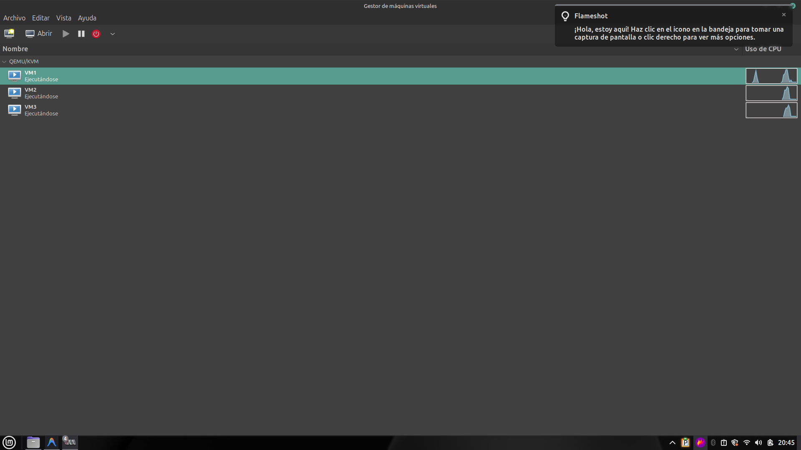
- [ ] **Evidencia 1.2:** Captura de la terminal de cada VM mostrando la versión de su respectivo runtime:
  - VM1: Resultado de ejecutar `sudo ctr version`.
    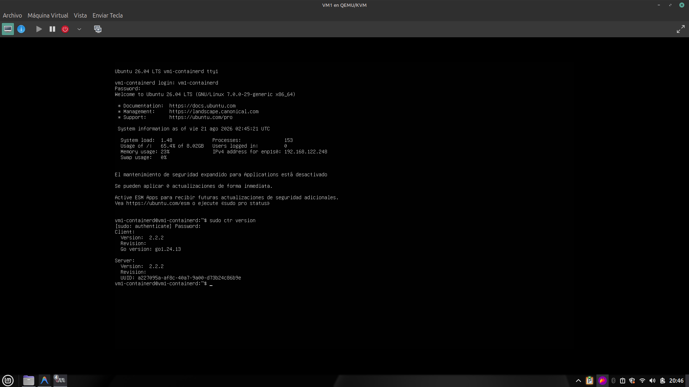
  - VM2: Resultado de ejecutar `podman --version`.
    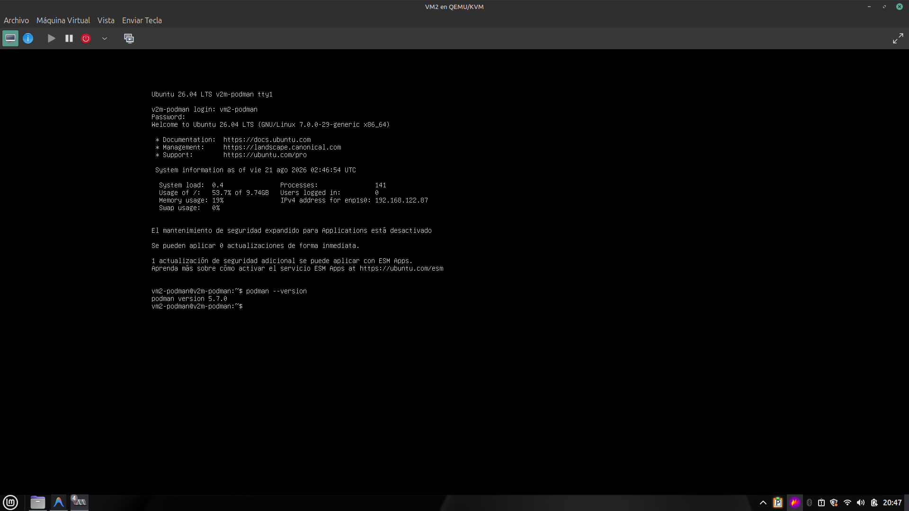
  - VM3: Resultado de ejecutar `docker --version`.
    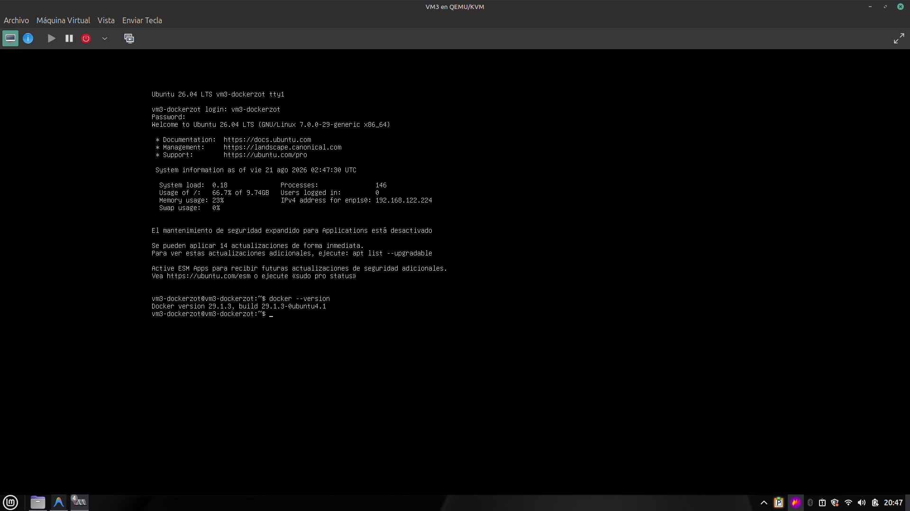

## Fase 2: Registros y Comunicación Cruzada

- [ ] **Evidencia 2.1 (Registro Zot):** Captura ejecutando `curl http://192.168.122.224:5000/v2/_catalog` desde cualquier VM, donde se observe el JSON con la lista de los 3 repositorios (api1, api2, api3) almacenados en Zot.
      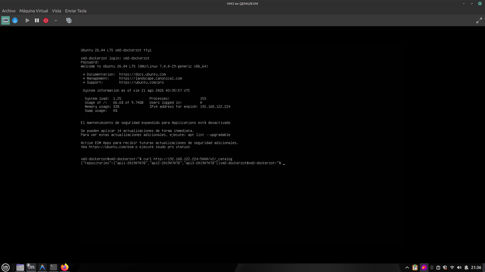
- [ ] **Evidencia 2.2 (Push/Pull):** Captura de la VM1 y VM2 realizando la descarga de imágenes.
  - VM1: Resultado de `sudo ctr images ls` mostrando las imágenes de Zot, API 1 y API2.
    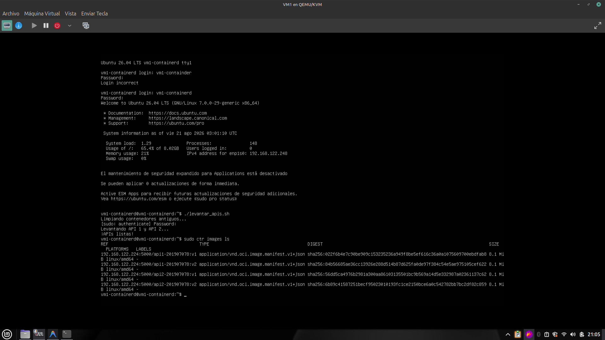
  - VM2: Resultado de `sudo podman images` mostrando la imagen de la API 3.
    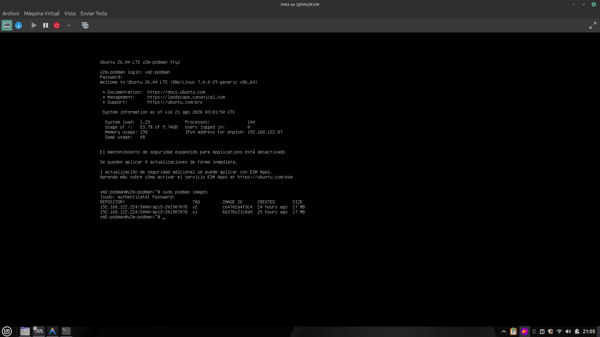

## Fase 3: Desarrollo de APIs y Endpoint /health

- [ ] **Evidencia 3.1 (Pruebas de Salud):** Capturas realizando peticiones directas al endpoint `/health` de cada API, evidenciando el JSON con los campos requeridos (`status`, `timestamp`, `VM`, `carnet`).
  - `curl http://192.168.122.248:8081/health`
    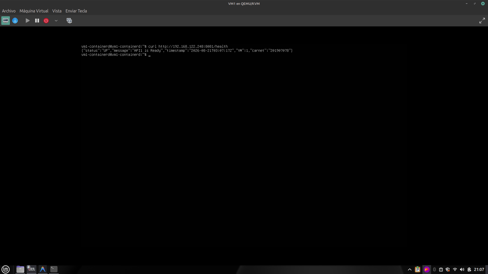
  - `curl http://192.168.122.248:8082/health`
    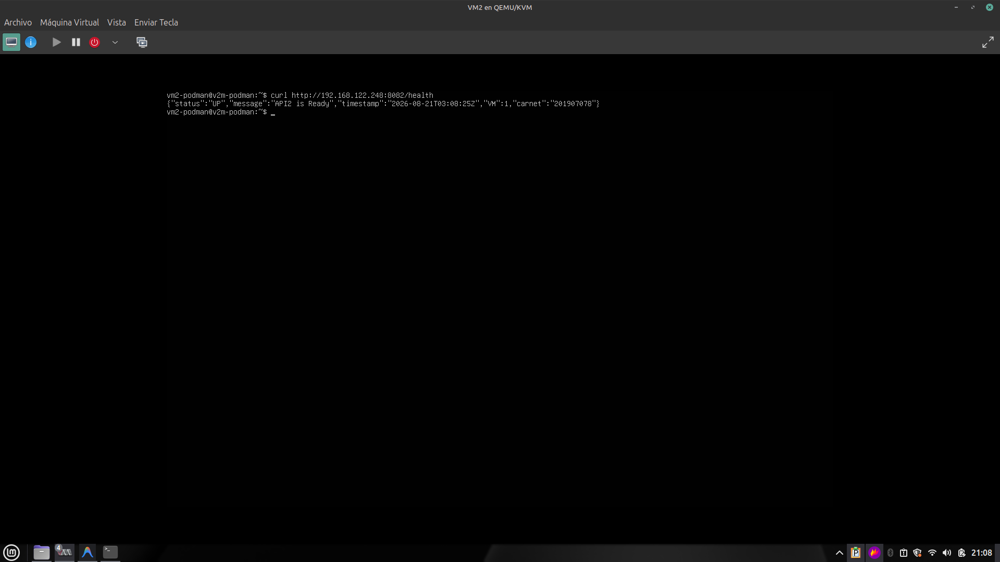
  - `curl http://192.168.122.87:8083/health`
    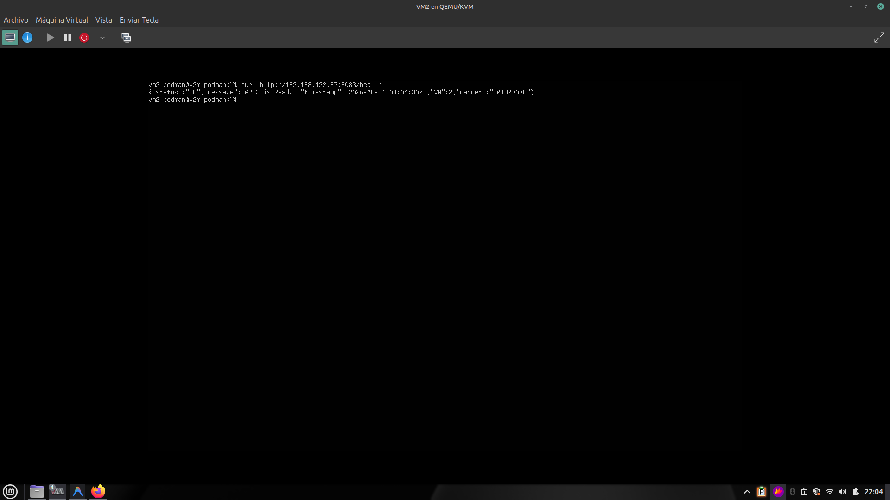

## Fase 4: Validación Final - Comunicación Cruzada

- [ ] **Evidencia 4.1 (API 1):** Captura ejecutando:
  - `curl http://192.168.122.248:8081/api1/201907078/call-api3`
  - Validar que devuelva el JSON con `"connection": true` y el mensaje correcto.
    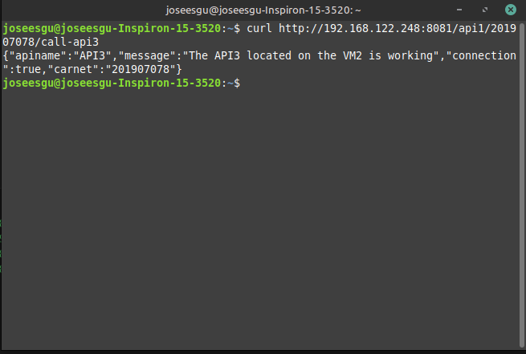
- [ ] **Evidencia 4.2 (API 2):** Captura ejecutando:
  - `curl http://192.168.122.248:8082/api2/201907078/call-api1`
    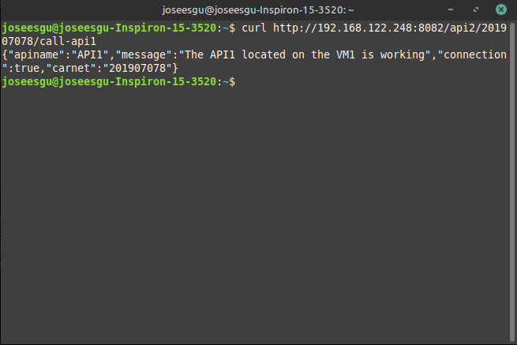
- [ ] **Evidencia 4.3 (API 3):** Captura ejecutando:
  - `curl http://192.168.122.87:8083/api3/201907078/call-api2`
    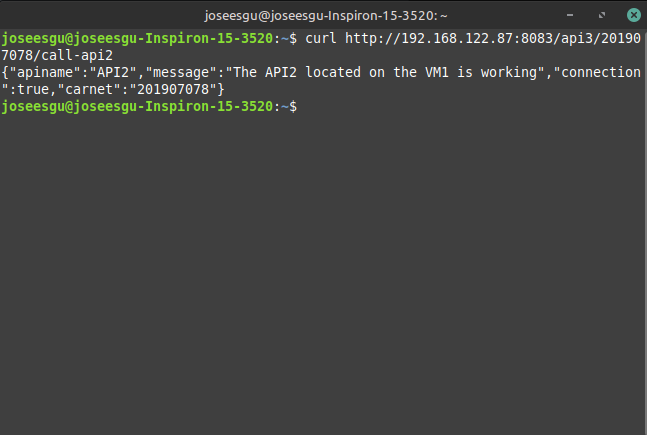
- [ ] **Evidencia 4.4 (Manejo de Errores):** Apagar momentáneamente la API 3 y ejecutar la Evidencia 4.1 para capturar el JSON demostrando `"connection": false` y el manejo correcto del error HTTP.
      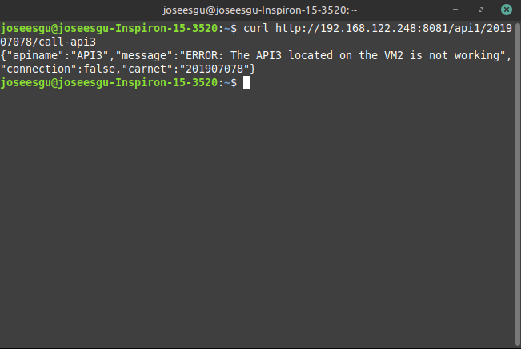
