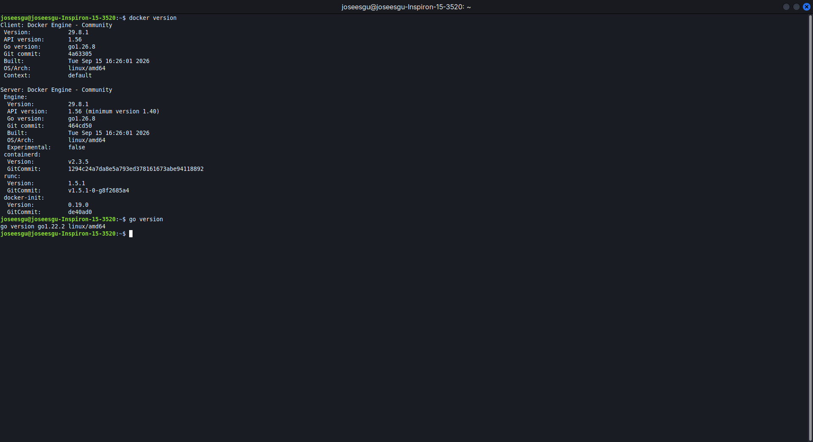
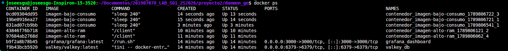
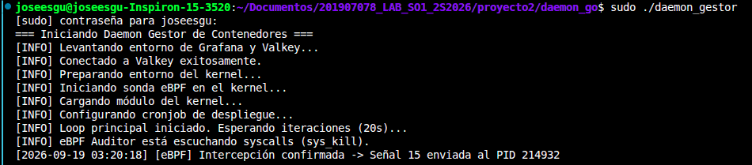

# Guía de Instalación - Monitor de Contenedores SO1

Este documento detalla los pasos y comandos necesarios para preparar el entorno en distribuciones basadas en Ubuntu/Debian (como Linux Mint) y ejecutar el proyecto de monitoreo con eBPF, Go, Valkey y Grafana.

## 1. Actualización del Sistema y Dependencias Base
Antes de instalar los componentes principales, es necesario actualizar los repositorios del sistema e instalar herramientas de compilación básicas.

```bash
sudo apt update && sudo apt upgrade -y
sudo apt install build-essential git curl software-properties-common -y
```

## 2. Instalación de Docker y Go
El orquestador está desarrollado en Go y la infraestructura de datos se levanta sobre contenedores Docker.

```bash
# Instalación de Go
sudo apt install golang -y

# Instalación de Docker
sudo apt install docker.io docker-compose-plugin -y
sudo systemctl enable --now docker
sudo usermod -aG docker $USER
```
> *Nota: Después de agregar el usuario al grupo de docker, es necesario cerrar sesión y volver a entrar, o usar `newgrp docker`.*



## 3. Instalación de Herramientas eBPF (BCC)
Para que el script de Python pueda compilar y cargar el código C de eBPF en el kernel en tiempo de ejecución, se requieren los headers del kernel de Linux y los bindings de BCC.

```bash
# Instalar los headers correspondientes a la versión actual del kernel
sudo apt install linux-headers-$(uname -r) -y

# Instalar las herramientas de compilación de BPF y el módulo de Python 3
sudo apt install bpfcc-tools python3-bpfcc -y
```

## 4. Despliegue de Infraestructura (Valkey y Grafana)
Los servicios de base de datos en memoria y el tablero de visualización están definidos mediante un archivo `docker-compose.yml`.

```bash
# Ubicarse en el directorio del proyecto
cd daemon_go/

# Levantar los contenedores en segundo plano
docker compose up -d
```


## 5. Compilación y Ejecución del Proyecto
Finalmente, compilamos el módulo del kernel para obtener las estadísticas del sistema operativo, y lanzamos el orquestador en Go.

```bash
# 1. Compilar y cargar el módulo del kernel
cd ../modulo_kernel
make
sudo insmod modulo_ram.ko

# 2. Compilar el daemon de Go
cd ../daemon_go
go build -o daemon_gestor main.go

# 3. Ejecutar el orquestador (requiere sudo para eBPF y Docker kill)
sudo ./daemon_gestor
```

