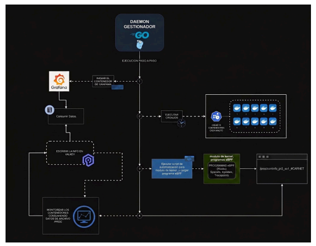
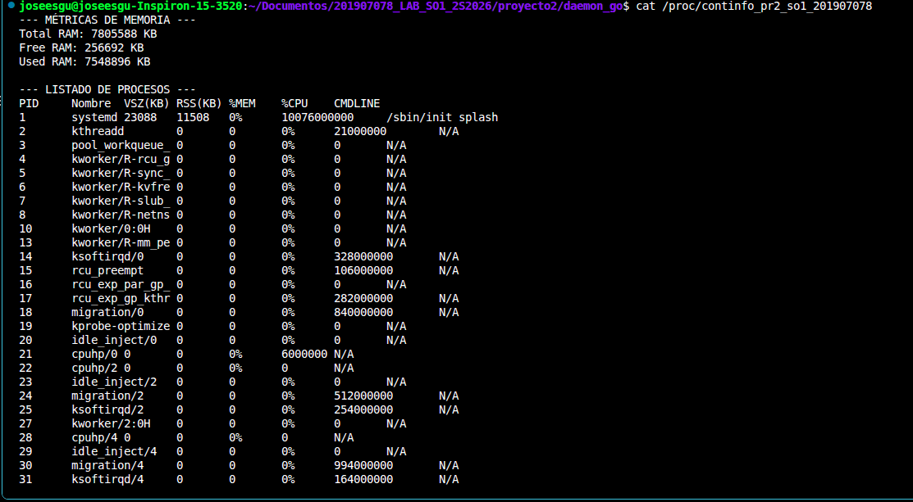
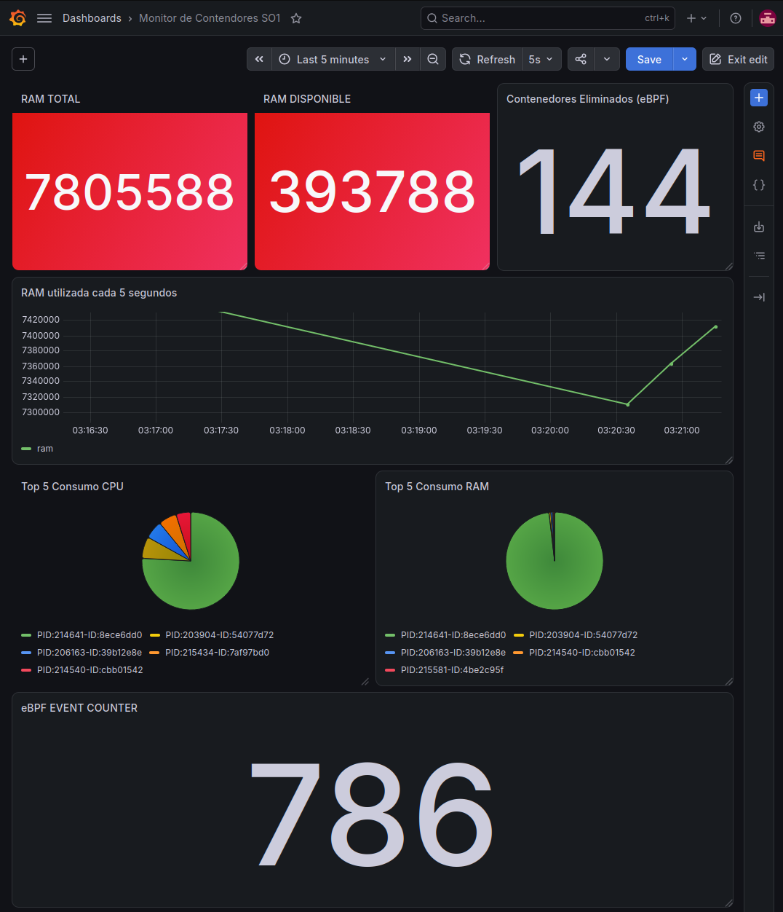
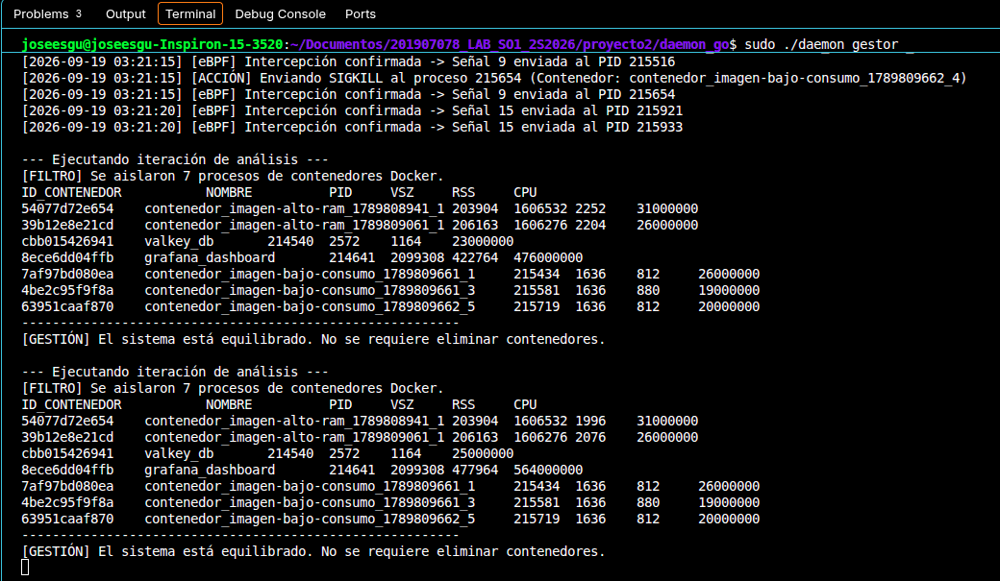

# Manual Técnico - Monitor de Contenedores SO1

**Universidad de San Carlos de Guatemala**
**Facultad de Ingeniería - Escuela de Ciencias y Sistemas**
**Sistemas Operativos 1 - Proyecto 2**
**Autores:** 
- José Manuel Estrada Gutiérrez - 201907078
---

## 1. Descripción General del Sistema
El sistema es una solución integral de observabilidad y control de recursos a nivel de sistema operativo. Su objetivo principal es monitorear el consumo de memoria RAM de contenedores Docker, aplicando restricciones estrictas para evitar el acaparamiento de recursos, y auditar las señales de terminación a nivel de kernel utilizando eBPF.

## 2. Arquitectura del Sistema
El proyecto se basa en una arquitectura de micro-componentes interconectados que leen directamente desde el hardware y orquestan decisiones de software. 

## 3. Descripción de Componentes

### 3.1 Módulo del Kernel (C)
Desarrollado en lenguaje C, este módulo se inyecta en el kernel de Linux. Se encarga de:
- Extraer el cálculo total, en uso y libre de la memoria RAM del sistema de la estructura `sysinfo`.
- Recorrer la lista de procesos (`task_struct`) para identificar contenedores.
- Exponer de forma estructurada esta información hacia el espacio de usuario a través de un archivo virtual en `/proc/continfo_pr2_so1_201907078`.

### 3.2 Sonda de Auditoría eBPF (Python + bcc)
Utiliza la tecnología BPF (Berkeley Packet Filter) para observar llamadas al sistema con un impacto casi nulo en el rendimiento.
- Emplea directivas `TRACEPOINT_PROBE` (`sys_enter_kill` y `sys_enter_tgkill`) para escuchar en tiempo real las señales enviadas a cualquier proceso en el sistema operativo.
- Filtra específicamente las señales `SIGKILL (9)` y `SIGTERM (15)`.
- Envía el *PID* y la señal interceptada de regreso al Daemon a través de la salida estándar.

### 3.3 Orquestador Gestor (Go)
Es el núcleo lógico del proyecto. Sus responsabilidades incluyen:
- Configurar un proceso `cron` en el sistema para ejecutar un script bash de despliegue de contenedores (`despliegue_aleatorio.sh`) cada minuto.
- Leer periódicamente el archivo `/proc` y analizar el consumo de CPU y RAM de cada contenedor.
- Aplicar políticas de tolerancia: si detecta sobrecarga en los contenedores, ejecuta comandos de sistema para emitir señales `SIGKILL`.
- Mantener persistencia métrica insertando y estructurando datos en Valkey.

### 3.4 Base de Datos de Streaming (Valkey) y Grafana
- **Valkey:** Configurado a través de Docker Compose como motor de almacenamiento en memoria. Utiliza estructuras dinámicas (`XADD`) para crear *streams* de tiempo continuo (Series de Tiempo) con las fluctuaciones de la RAM.
- **Grafana:** Herramienta de visualización web conectada a Valkey mediante el plugin `redis-datasource`. Realiza consultas como `XRANGE` para pintar gráficos históricos continuos.

## 4. Flujo de Ejecución y Lógica Interna

1. **Generación de Entorno:** El demonio Go arranca, inicializa los contadores en Valkey (mediante directivas de seguridad como `SetNX` para evitar sobreescritura de historiales) y activa el Cronjob.
2. **Lectura Continua:** En intervalos de 5 segundos, Go accede al sistema de archivos `/proc` y carga en memoria las estadísticas enviadas por el módulo del kernel. 
3. **Restricción de Recursos:** Se evalúan las políticas (manteniendo 3 contenedores de bajo consumo y 2 de alto consumo). Si hay una desviación, el código Go ejecuta un `syscall.Kill(PID, syscall.SIGKILL)`.
4. **Intercepción eBPF:** En el mismo milisegundo en que Go lanza la llamada al sistema, la sonda eBPF alojada en el kernel detecta la interrupción de señal 9. Extrae los argumentos (PID y Señal) y los devuelve.
5. **Registro con Timestamp:** Go formatea la confirmación proveniente de eBPF asignándole un log temporal preciso (`[2026-09-19 02:35:45] [eBPF] Intercepción confirmada...`) e incrementa de forma clasificada los eventos en Valkey:
   - Se incrementa el totalizador global para cualquier intercepción de eBPF.
   - Se incrementa el contador de contenedores eliminados **únicamente** si la señal verificada es la 9.

